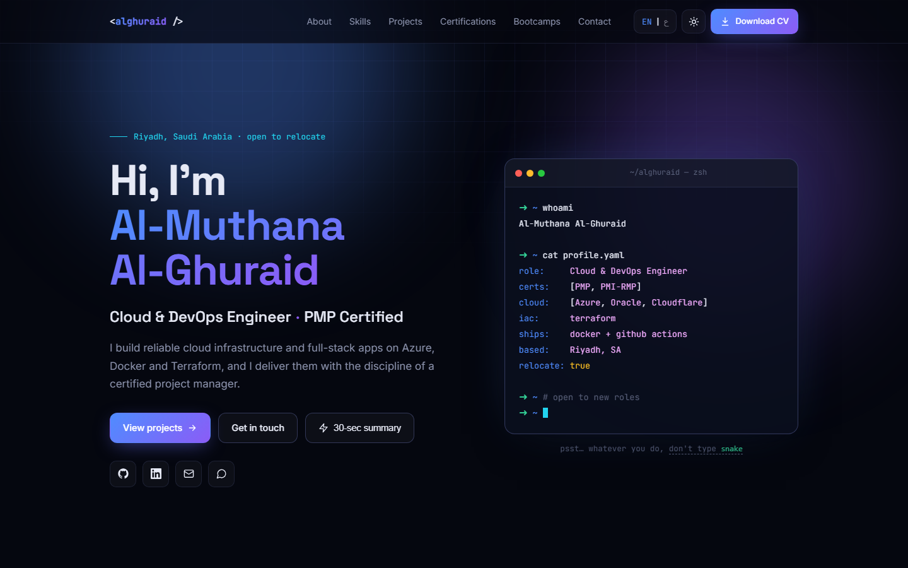
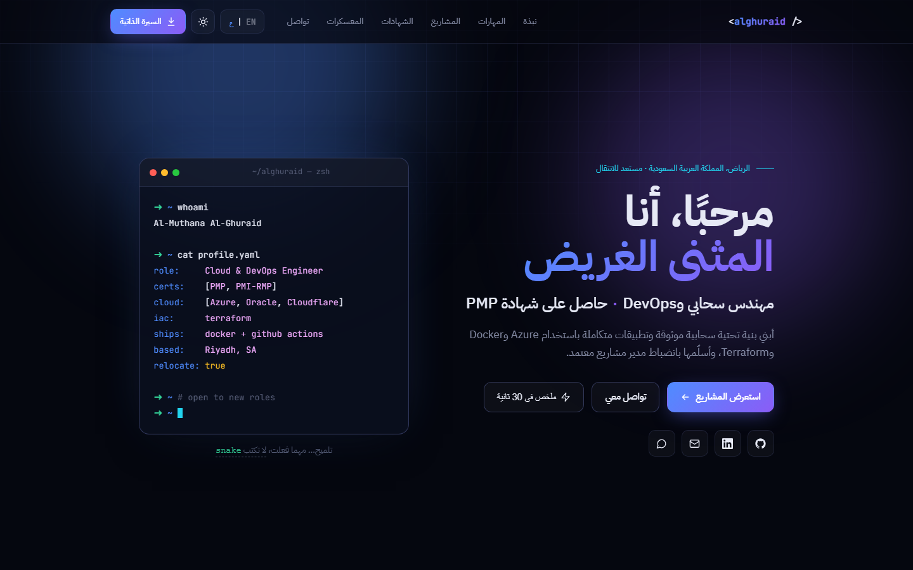
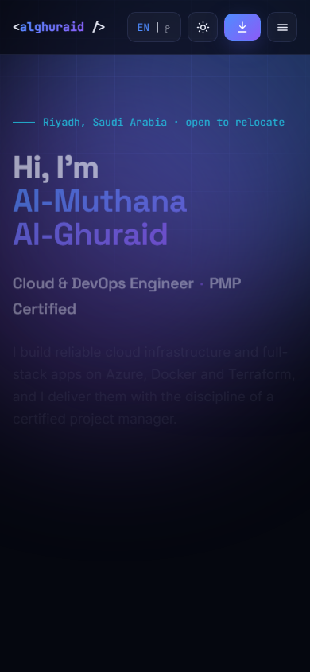
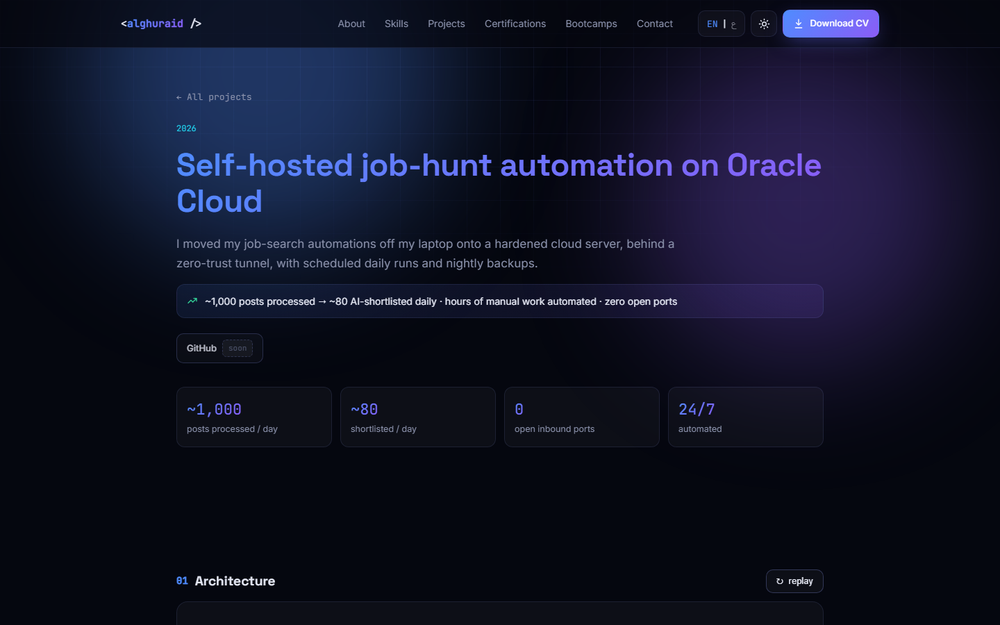
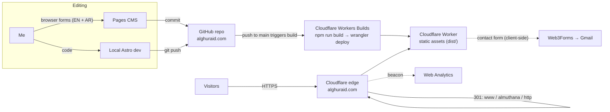
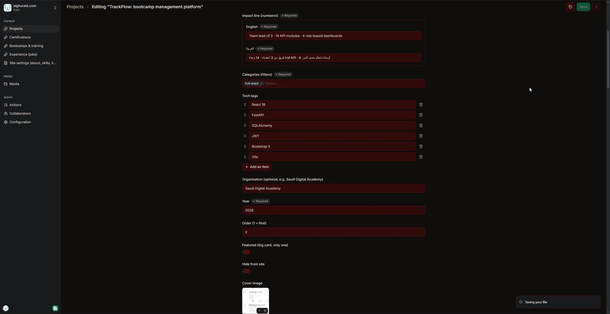

# alghuraid.com: bilingual portfolio on Cloudflare

**Live:** https://alghuraid.com · Arabic version: https://alghuraid.com/?lang=ar

My personal portfolio, designed and built from scratch and run as a small production system:
a content-driven Astro site with a full **English / Arabic (right-to-left)** experience, a browser-based
admin panel for editing content without code, and a **GitHub → Cloudflare** pipeline that deploys
every change worldwide in about a minute, on my own domain with HTTPS, redirects and analytics.



| Arabic (RTL) | Phone | Project case study |
|---|---|---|
|  |  |  |

---

## Highlights

- **Bilingual with real RTL.** One toggle flips the whole layout to Arabic, right to left, with an Arabic typeface.
  English terms and numbers inside Arabic text are isolated (`<bdi>`) so "Security+", "2019–2024" and "~1,000" keep their order.
  Every visible string, including the Easter egg, exists in both languages; the content schema makes Arabic mandatory.
- **Content-driven.** Projects, certifications, bootcamps and jobs are one YAML file each, validated by a typed schema.
  Counts, filters, totals (training hours), the sitemap, the terminal profile and the recruiter summary are all computed from content.
- **Admin panel without a server.** [Pages CMS](https://pagescms.org) gives bilingual forms in the browser; saving commits to GitHub, which triggers a deploy.
- **Interactive details.** A typing terminal in the hero that turns into a live prompt (with a hidden Snake game),
  project filters, a 30-second recruiter summary, scroll animations, dark/light theme, and an
  animated SVG architecture diagram on case-study pages. All motion respects `prefers-reduced-motion`.
- **Production setup.** Custom domain, forced HTTPS, 301 redirects (`www` and `almuthana` → apex, keeping path and query),
  social share image, sitemap, privacy-friendly analytics (no cookies), and a working contact form.

## Architecture



More detail: [docs/ARCHITECTURE.md](docs/ARCHITECTURE.md) · Design and technical decisions: [docs/DECISIONS.md](docs/DECISIONS.md)

## Stack

| Layer | Choice |
|---|---|
| Framework | [Astro 7](https://astro.build), static output, TypeScript, content collections with Zod schemas |
| Styling | Hand-written CSS (custom properties, logical properties for RTL), Space Grotesk / Inter / JetBrains Mono / IBM Plex Sans Arabic |
| Content | YAML + JSON in `src/content/`, edited through Pages CMS (`.pages.yml`) |
| Hosting | Cloudflare Workers (static assets) with Workers Builds connected to GitHub |
| Domain / edge | Cloudflare Registrar + DNS, custom domains, Redirect Rules, Always Use HTTPS |
| Forms / analytics | Web3Forms (public access key), Cloudflare Web Analytics |
| Cost | Free tiers only, apart from the domain |

## Project structure

```
src/
  content/            # ← all site content (one file per item) + settings.json
    projects/  certifications/  bootcamps/  experience/
  content.config.ts   # typed schema; Arabic required, empty CMS fields tolerated
  i18n/ui.ts          # interface strings (EN/AR) + date helpers
  components/         # T (bilingual text), cards, sections, diagrams
  pages/              # home, /projects/[id]/, sitemap.xml
  scripts/            # language/RTL, theme, animations, filters (site.ts); terminal + Snake (terminal.ts)
public/               # images, CV, share image, robots.txt
.pages.yml            # admin panel forms
wrangler.jsonc        # Cloudflare Worker config (serves dist/)
docs/                 # architecture, decisions, playbook, screenshots
```

## Editing content

Everything visible comes from `src/content/`; no code changes are needed to add, edit, hide or reorder items.

| File / folder | Controls |
|---|---|
| `projects/*.yaml` | Project cards, filters and each `/projects/<file-name>/` page |
| `certifications/*.yaml` | Certification cards (`active`, `in-progress`, `expired`) |
| `bootcamps/*.yaml` | Bootcamp cards; hours and counts are totalled automatically |
| `experience/*.yaml` | Experience section, hidden until the first entry exists |
| `settings.json` | Name, headline, about, skills, links, availability, form key |

Usually this happens in the admin panel at https://app.pagescms.org.



## Development

```bash
npm install
npm run dev      # http://localhost:4321
npm run build    # static site in dist/
```

Deploys happen automatically on every push to `main`. To put a new project online at `name.alghuraid.com`
with the same setup, follow [docs/NEW_PROJECT_PLAYBOOK.md](docs/NEW_PROJECT_PLAYBOOK.md).

## Built with

Designed and built with **Claude Code** (AI pair-programming), with every design, content and infrastructure
decision made and reviewed by me, from the interview and mockup stage to production.
