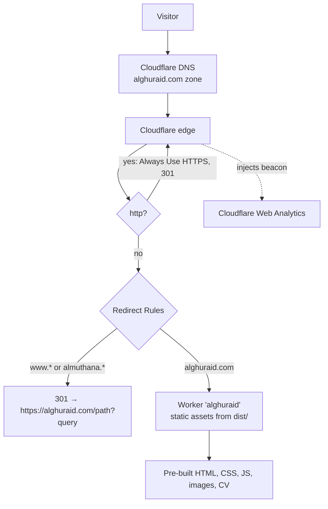
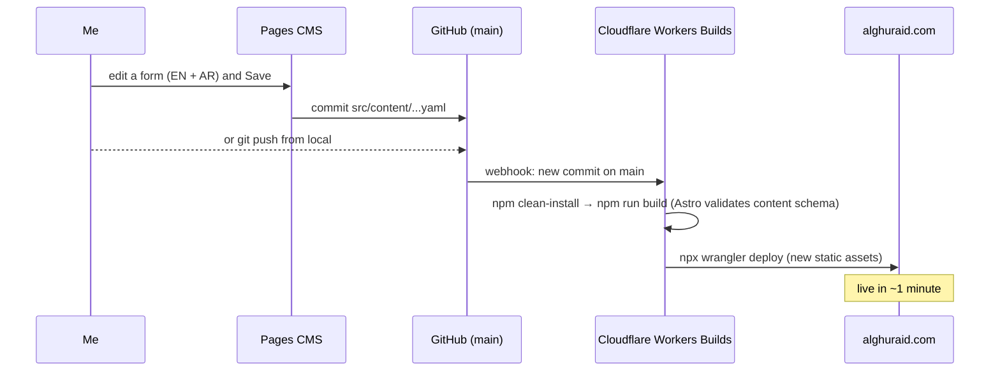
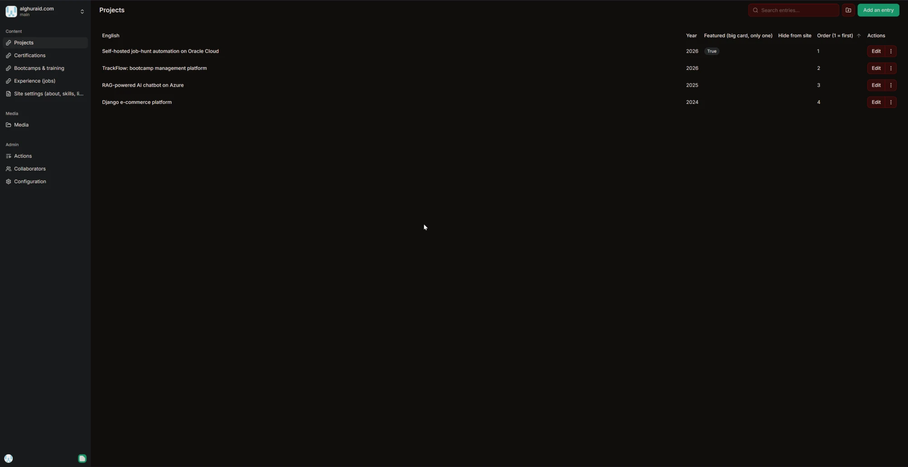
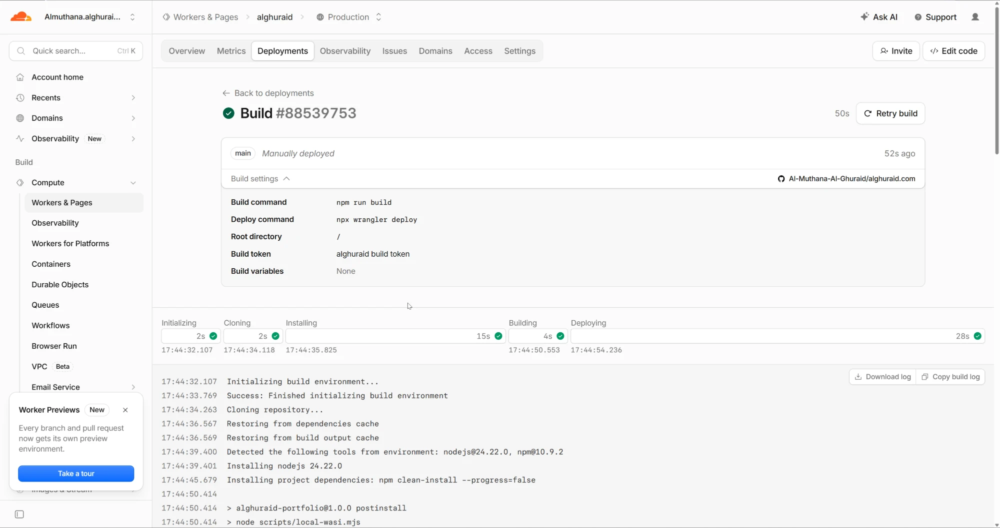
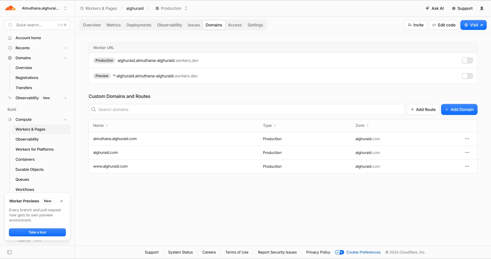
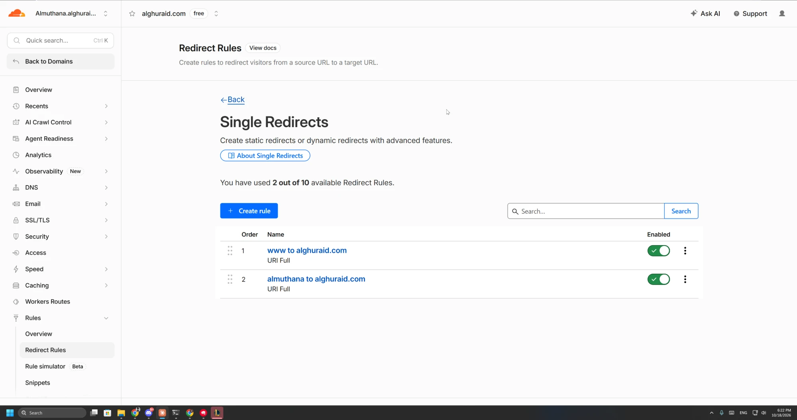
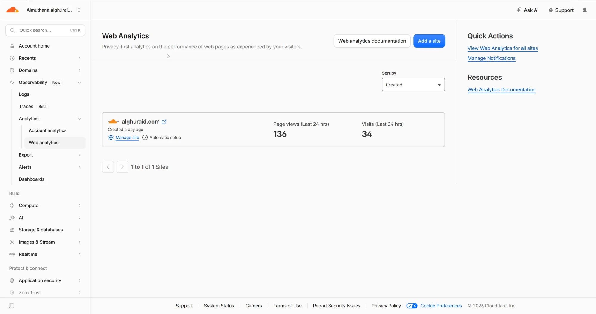

# Architecture

## Request flow

- **No origin server.** The site is fully static; the Worker only serves files built into `dist/` (`wrangler.jsonc`, `assets.directory`).
- **Custom domains** `alghuraid.com`, `www.alghuraid.com` and `almuthana.alghuraid.com` are attached to the Worker; Cloudflare manages their DNS records and certificates.
- **Redirect Rules** run before the Worker, so `www` and `almuthana` never render the site themselves; they answer `301` to the apex, preserving the path and query string.
- Other subdomains on the zone (e.g. a private automation server) are separate and unaffected.

## Deploy flow

If content breaks the schema (for example a malformed date), the build fails and the previous version stays live.

## Inside the site

| Concern | How it works |
|---|---|
| **Content model** | `src/content.config.ts` defines four collections with Zod. Main texts are `{ en, ar }` with both required; optional fields accept empty values from the CMS and normalise them away. |
| **Derived data** | `src/lib/data.ts` loads collections once, drops `hidden` items, sorts by `order`, and computes totals (training hours, programs, capstones) and filter counts. |
| **Bilingual text** | `<T v={{en, ar}}>` renders English plus a `data-ar` attribute. `src/scripts/site.ts` swaps every `[data-ar]` element, sets `dir="rtl"`, then wraps Latin runs in `<bdi dir="ltr">`. The choice persists in `localStorage`, or comes from `?lang=ar`. A tiny inline script applies it before first paint. |
| **Pages** | `/` (all sections) and `/projects/[id]/` generated per project file; `sitemap.xml` generated from the same data. |
| **Interactivity** | Vanilla TypeScript: IntersectionObserver reveals and counters, card spotlight, project filters, modals, the self-drawing SVG diagram (CSS `stroke-dashoffset` plus `animateMotion`), and the terminal with a canvas Snake game. |
| **Contact form** | Posts `FormData` to Web3Forms with a public access key and a honeypot field; success and error messages are bilingual. Without JavaScript it falls back to a normal form post. |
| **Share previews** | Open Graph and Twitter tags on every page; a 1200×630 `og.png` (project pages use their own cover when it's PNG/JPG). |

## Admin panel

Pages CMS reads `.pages.yml` and renders forms for each collection plus `settings.json`.
It authenticates with GitHub and is installed **only on this repository**; saving creates a normal commit, so the deploy flow above applies unchanged.

## Infrastructure screenshots

| Build | Domains | Redirects | Analytics |
|---|---|---|---|
|  |  |  |  |
